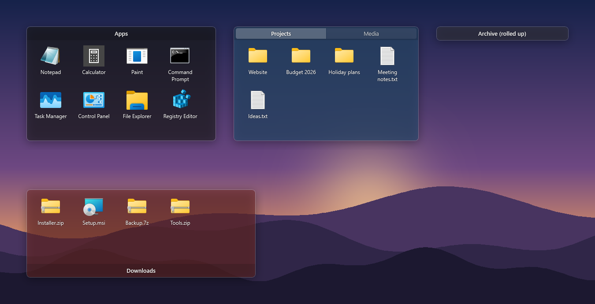
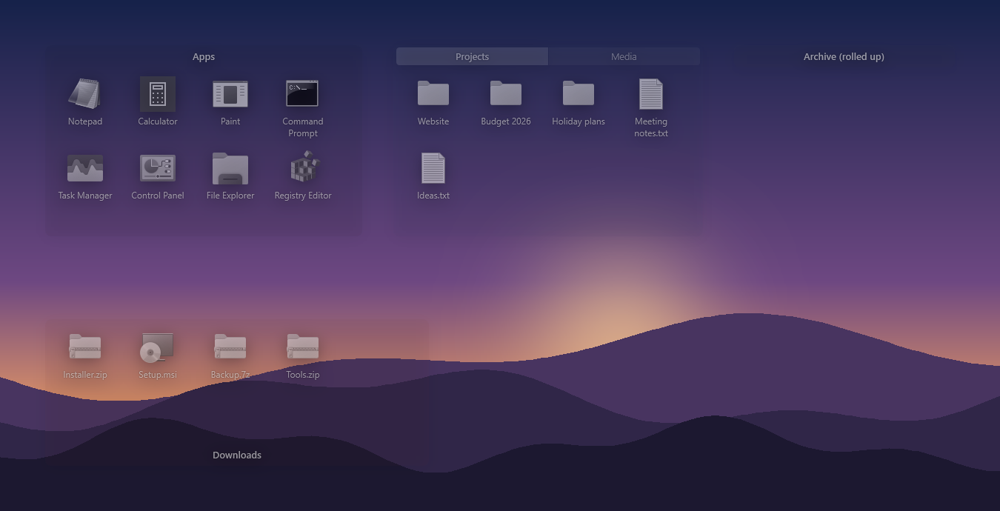
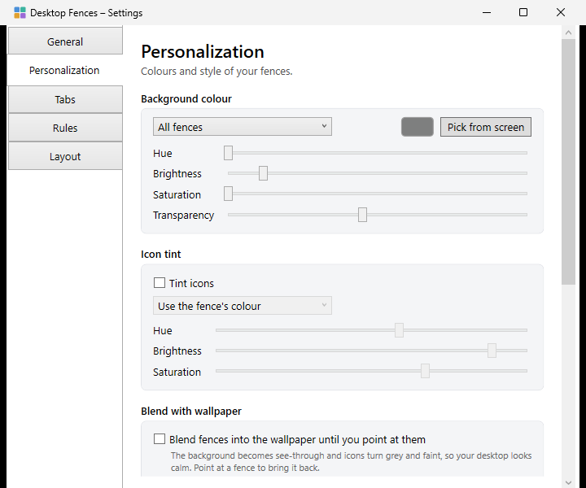
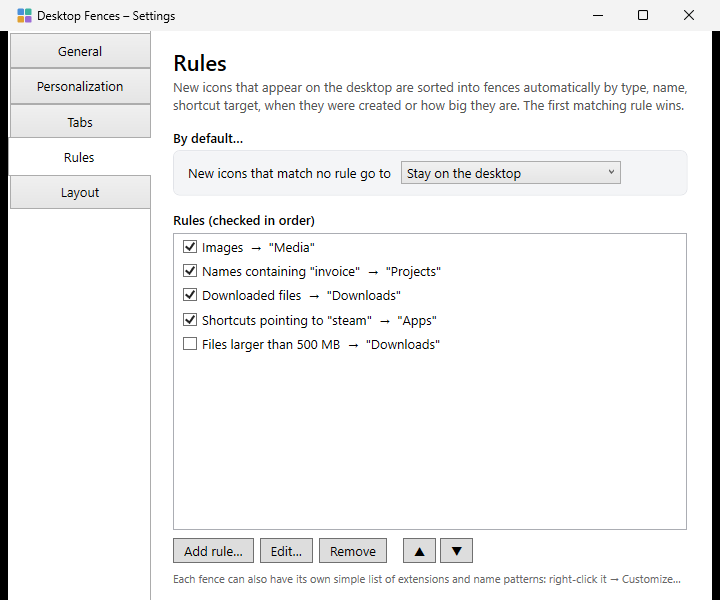
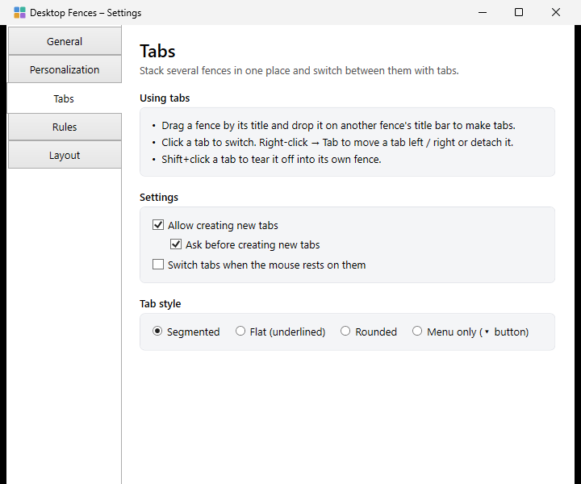
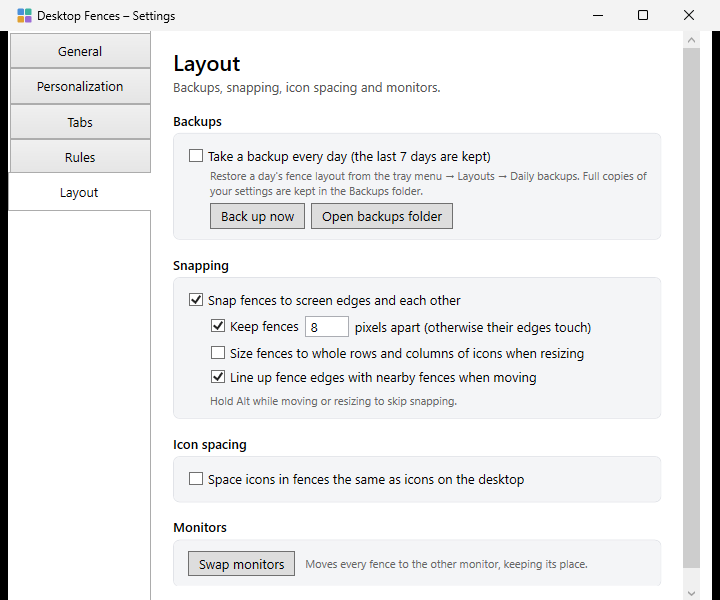

# Desktop Fences

A small, free, open-source desktop organiser for Windows 10/11. It groups your desktop icons into translucent, resizable panels ("fences") that sit on the wallpaper behind your windows. It's an alternative to Stardock Fences, built with C# and WPF on .NET 8.



## Download

Get `DesktopFences.exe` from the [Releases](../../releases) page and run it. There's no installer.

It needs the **[.NET 8 Desktop Runtime](https://dotnet.microsoft.com/download/dotnet/8.0)** (x64). If the runtime is missing, Windows will offer to download it.

On the first run, it offers to sort your desktop into fences automatically.

> **Coming from Stardock Fences?** Remove your fences in Fences (or uninstall it) so your icons are back on the plain desktop, and quit it before starting Desktop Fences.

## Features

| | |
|---|---|
| **Fences** | Drag icons from the desktop into a fence. Drag them out onto the desktop to take them out of the fence. Drag between fences, or within a fence to rearrange. |
| **Real icons, real menus** | Double-click opens. Right-click shows the normal Explorer menu (Open with, Send to, Properties…) plus "Remove from fence". Delete = Recycle Bin, F2 = rename, Enter = open. |
| **Folder portals** | A fence that shows the live contents of any folder. Dropping files on it moves them into that folder (hold Ctrl to copy). |
| **Roll up** | Double-click a fence's title to roll it up to just the title bar. It unrolls while your mouse is over it, sliding open and shut (speed: Instant / Quick / Smooth / Slow in Settings → Personalization). **Roll up all** / **Unroll all** are in the tray menu. |
| **Tabs** | Drop one fence on another fence's title bar to stack them as tabs. Click a tab to switch (or rest the mouse on it, if turned on). Right-click → **Tab** to reorder or detach, or Shift+click a tab to tear it off. Four tab styles: segmented, flat, rounded, or a ▾ menu. |
| **Blend with wallpaper** | Fences turn see-through with grey, faint icons until you point at one (Settings → Personalization). |
| **Title bar at the bottom** | A fence in the lower half of the screen moves its title bar to its bottom edge, and rolls up (and unrolls) towards the bottom, so it never unrolls off-screen. You can also fix it to the top or bottom: right-click the fence and choose **Title bar**. |
| **Quick-hide** | Double-click empty desktop space, left-click the tray icon, or press **Ctrl+Alt+H** to hide or show all fences. |
| **Bring to front** | **Ctrl+Alt+F** (or the tray menu) lifts all fences above your open windows. They go back to the desktop when you switch to another window or press it again. |
| **Layouts and backups** | Tray menu → **Layouts** saves where your fences are (position, size, rolled up) and restores it later. A backup is also taken automatically every day (the last 7 are kept), and full copies of your settings go to the `Backups` folder. **Swap monitors** moves every fence to the other screen. |
| **Rules** | Settings → **Rules** sorts new desktop icons into fences by type (folders, documents, images, music & video, downloaded files, web links, program shortcuts), name (contains / starts with / ends with), where a shortcut points, when it was created (hours or days of the week), or file size. You can also send everything that matches no rule to a default fence. |
| **Per-fence capture lists** | Right-click a fence → **Customize…** and list extensions (`.lnk, .url`) or name patterns (`*invoice*`, `Screenshot*`). `*` catches anything no other fence claims. |
| **Auto-organise** | From the tray menu. Creates Shortcuts / Folders / Documents / Images & Media / Installers & Archives / Other fences. |
| **Look** | Per fence: colour, opacity, text colour (automatic dark text on pale fences), rename, sort (manual, name, type, date), lock position. In Settings → Personalization: hue / brightness / saturation / transparency sliders for one fence or all of them (with a pick-from-screen eyedropper), icon tint (the fence's colour or your own), title bars always shown / on mouse-over / never, icon size, title alignment, rounded or square corners, icon names on or off, fading when idle, animated icon moves, and scrollbars hidden until you point at a fence. |
| **Single-click** | Optionally open items with one click instead of two (Settings). |
| **Snapping** | Fences snap to screen edges and to each other while you move or resize them. Choose the gap between fences, line edges up with neighbours, and size fences to whole rows and columns of icons (Settings → Layout). Hold Alt to turn snapping off. Icons can also use the same spacing as the desktop. |
| **Always on screen** | Fences can't be moved or resized past the edge of a monitor. A fence left off-screen (e.g. after unplugging a monitor) is pulled back onto the nearest one. Right-click a fence → **Move to centre of screen**, or use the tray menu → **Move all fences to centre of screen** to gather them all. |
| **Show desktop** | Fences stay visible after Win+D. |
| **Start with Windows** | Turn it on in Settings → General (tray menu → Settings…). |
| **Lock all** | Tray menu → **Lock all fences** stops every fence from being moved or resized. |


## Screenshots

**Blend with wallpaper** – the same desktop while you're not pointing at a fence:



**Settings**

| | |
|---|---|
|  |  |
| **Personalization** – colours for one fence or all, icon tint, blending, title bars | **Rules** – sort new desktop icons into fences automatically |
|  |  |
| **Tabs** – stack fences as tabs, four tab styles | **Layout** – daily backups, snapping, icon spacing, monitors |


## How hiding works

Nothing is moved or deleted. A file you put in a fence gets the *Hidden + System* attributes. Explorer then keeps it off the bare desktop, even when "Show hidden items" is on. System icons like the Recycle Bin use Explorer's own "hide desktop icon" setting instead.

The app keeps a list of what it hid and only ever un-hides those items. Before a fenced file is copied, moved or deleted, it takes the attributes off, so the result isn't invisible. It puts them back once the operation is done.

- **Put icons back on desktop & quit** (tray menu) restores everything. Use it before uninstalling.
- Shortcuts on the shared *Public* desktop (`C:\Users\Public\Desktop`) need admin rights to change. These changes are batched into a single UAC prompt. If you decline, those shortcuts stay visible on the desktop and still work in fences.
- If Explorer is set to show *protected operating system files*, fenced icons will still appear, faded.

## Data

| What | Where |
|---|---|
| Settings and layout | `%APPDATA%\DesktopFences\config.json` (a `.bak` copy of the previous version is kept next to it) |
| Log | `%APPDATA%\DesktopFences\log.txt` |
| Daily backups | `%APPDATA%\DesktopFences\Backups\` (last 7 days) |

## Building

Requires the .NET 8 SDK or newer.

```bash
dotnet publish DesktopFences -c Release -r win-x64 --self-contained false -p:PublishSingleFile=true -o publish
```

Run the checks for the desktop-hiding logic (they only touch files in a temp folder):

```bash
dotnet run --project tests/DesktopFences.Tests
```

To try changes without touching your real fences, run the app with its own config folder:

```bash
DesktopFences.exe --config C:\temp\fences-test
```

Releases are built by GitHub Actions ([.github/workflows/build.yml](.github/workflows/build.yml)). Pushing a tag such as `v1.0.0` builds the exe and attaches it to a GitHub Release.

### Project layout

```
DesktopFences/
  App.xaml(.cs)          startup, single instance, elevated helper mode (--apply-attrs)
  FenceManager.cs        owns all fences: hiding, desktop watcher, z-order, snapping, auto-organise
  FenceWindow.xaml(.cs)  one fence: items, drag & drop, roll-up, menus
  TrayIcon.cs            notification-area icon and menu
  Dialogs/               settings, fence customisation, rule editor, rename
  Services/              desktop hiding, shell icons/menus, sorting rules, icon effects, hotkeys, file watching, config, Win+D handling
  Interop/               Win32 / shell COM declarations
tests/DesktopFences.Tests/  checks for the hide / release / re-hide logic
```

## Disclaimer

This is an independent project, not affiliated with or endorsed by Stardock. "Fences" is a trademark of Stardock Corporation.

## License

[MIT](LICENSE)
